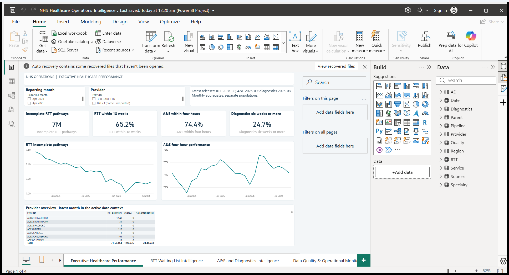
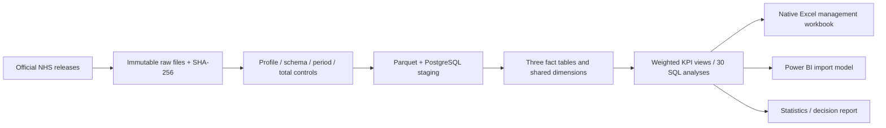
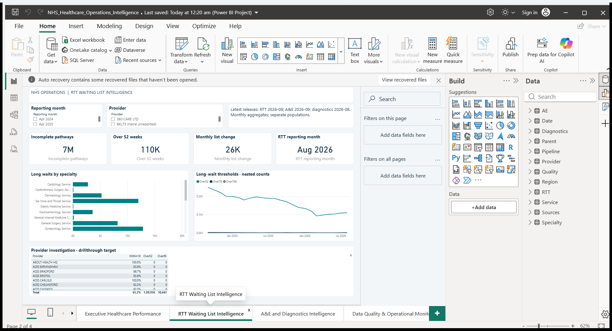
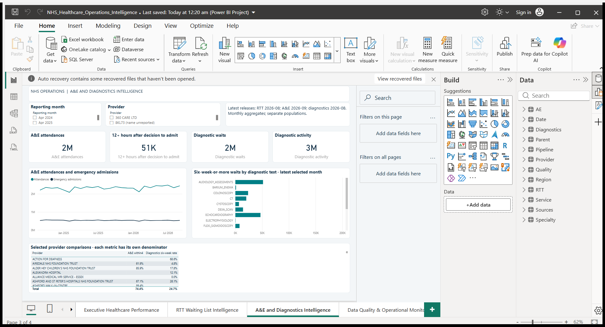
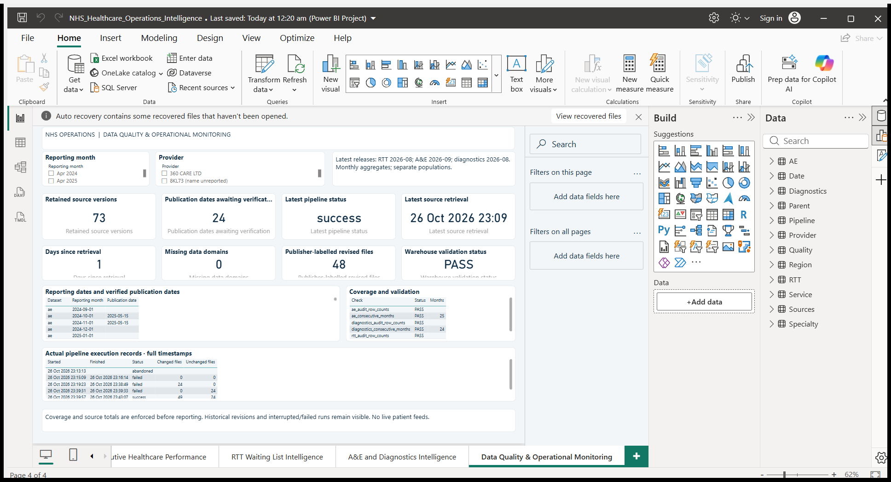

# NHS Healthcare Operations & Performance Intelligence

**A reproducible NHS England operational analytics portfolio: Python, PostgreSQL, Excel and Power BI.**

Published aggregate data become validated waiting-list, urgent-care and diagnostic intelligence for an operational planning team. Separate care populations, weighted denominators, immutable source provenance and executable evidence underpin every finding. This is an independent portfolio project; NHS England does not endorse it.



*Genuine project-window capture. The report shows separately dated RTT, A&E and diagnostics populations; the displayed values are a recorded snapshot.*

**Review in three minutes:** [business findings](reports/NHS_Healthcare_Executive_Decision_Report.md) · [30 SQL analyses](sql/analytics/) · [Excel workbook](excel/NHS_Healthcare_Executive_Analysis.xlsx) · [Power BI project](powerbi/NHS_Healthcare_Operations_Intelligence.pbip) · [validation evidence](docs/testing/FINAL_INDUSTRY_AUDIT.md)

| Business value | Technical evidence |
|---|---|
| Investigate long waits, provider variation and deteriorating performance | 73 official source files; three fact tables; 403,839 fact rows |
| Explain what a KPI means before recommending action | 33 documented KPI definitions; 30 executed SQL analyses |
| Support a repeatable operational review | Python pipeline; PostgreSQL; native Excel; four Power BI pages; 47 recorded passing tests |

The tests and metrics below describe committed validation evidence; they are not a claim that a fresh desktop refresh has run on this visit.

## Verified analytical position

- **RTT — 2026-08:** 7,158,164 submitted incomplete pathways; 65.2% within 18 weeks; 109,936 over 52 weeks.
- **A&E — 2026-09:** 2,444,743 attendances; 74.4% completed within four hours; 50,582 decision-to-admit waits of 12+ hours.
- **Diagnostics — 2026-08:** 1,833,070 waits; 24.7% waiting six weeks or more.

These counts are different populations and must never be added into a unique-patient figure. RTT excludes estimates for missing trusts and non-English commissioned NONC records. A&E includes separately published booked attendance fields and uses provider reporting rather than acute-trust footprint attribution.

| Dataset | Consecutive months | Validated fact rows |
|---|---:|---:|
| ae | 25 | 4,918 |
| diagnostics | 24 | 162,750 |
| rtt | 24 | 236,171 |

73 authentic source files, 7,918,106 raw rows including controls and 403,839 analytical fact rows. Raw sources are retained locally; the public manifest records exact official URLs, reporting periods, checksums, retrieval timestamps and revision labels.

## Business questions and findings

Which specialties and providers account for long waits? Which providers show consecutive deterioration? How do Type 1 and all-department A&E measures differ? Which diagnostic tests concentrate six-week waits? What changes remain in a stable-code provider cohort? Are sources complete, revised and current enough for the next performance review?

The [BRD](docs/requirements/BUSINESS_REQUIREMENTS.md) defines 24 questions. The [33-KPI dictionary](docs/kpi_definitions/KPI_DICTIONARY.md) specifies meaning, numerator, denominator, calculation, scope, caveats and validation. The [executive decision report](reports/NHS_Healthcare_Executive_Decision_Report.md) provides actual calculated findings, named investigation roles and monitoring KPIs. The [stakeholder briefing](reports/Stakeholder_Briefing.md) is ready to adapt into a management presentation. Recommendations are proposed investigations, not claimed savings or delivered improvements.

## Architecture and lineage



The [warehouse diagram and decisions](docs/architecture/ARCHITECTURE.md) explain fact grains, source ICB versus reporting-region geography, single-direction relationships and revision handling. The [data dictionary](docs/data_dictionary/DATA_DICTIONARY.md) explains the physical tables and source conventions. Providers keep their official codes; a trust, site, commissioner and ICB are never assumed to be the same entity.

## Working implementation and evidence

- **Python:** modular ingestion, Pandas/NumPy transformations, explicit missing values, retries/timeouts, structured logging, immutable files, parser-version caches, transactional changed-month loads and audit records.
- **PostgreSQL:** four schemas, staging, three constrained facts, six dimensions, analytical views, indexes, safe aggregate joins and row-count reconciliation.
- **SQL:** 30 executed analyses demonstrate CTEs, subqueries, joins, ROW_NUMBER, RANK, DENSE_RANK, LAG, LEAD, calendar YoY, rolling/running windows, conditional aggregation and percentiles. [Query sources](sql/analytics/) and [actual results](reports/sql_results/) accompany recorded [EXPLAIN ANALYZE evidence](reports/validation/explain_analyze.json).
- **Statistics:** descriptive distributions, exploratory block-bootstrap intervals for temporal variability and a chronological comparison of persistence versus seasonal-naive baselines. No invented p-values or causal claims. [Results](reports/statistical_analysis.json) and [executed EDA notebook](notebooks/01_nhs_operational_eda.ipynb).
- **Excel:** PASS; 11 sheets, 5 native charts, 1 genuine PivotTable and 1 stored Power Query query. Native formulas include XLOOKUP, SUMIFS, COUNTIFS, rates and an explicitly hypothetical scenario. [Workbook](excel/NHS_Healthcare_Executive_Analysis.xlsx) · [calculation/reconciliation evidence](reports/validation/excel_validation.json). The stored Power Query has not been refreshed through an external connection; the workbook is the validated exported snapshot.
- **Power BI:** four PBIR report pages, a TMDL model, slicers, provider drillthrough configuration, tooltips and 50 DAX measures. 59 metadata files pass Microsoft schemas; TOM parser status: PASS. **Desktop/DAX completion: COMPLETE**. [Open the PBIP](powerbi/NHS_Healthcare_Operations_Intelligence.pbip) · [desktop evidence](reports/validation/powerbi_desktop.json) · [DAX reconciliation](reports/validation/dax_reconciliation.json).
- **Tests:** 47 passed, 0 failed, 0 errors, 0 skipped in the recorded final local suite. [JUnit evidence](reports/validation/all_tests.xml). Synthetic fixtures are clearly labelled; integration checks use retained genuine NHS data. GitHub Actions runs unit/lint checks; official-data integration is manual-dispatch to control download/runtime cost.

## Dashboard pages and preview gallery

1. Executive Healthcare Performance — separately dated KPIs and trends.
2. RTT Waiting List Intelligence — specialties, long waits and provider investigation.
3. A&E and Diagnostics Intelligence — attendances, admissions and diagnostic tests.
4. Data Quality & Operational Monitoring — source dates, checksum lineage and actual run history.

The executive capture is shown above. These additional images capture the actual Power BI project window. The [calculated national-trend figure](reports/figures/national_trends.png) is a separate analytical export. Open the committed PBIP for the editable report; no PBIX is supplied. See the final audit for UI checks and limitations.

<details>
<summary>View the RTT, A&E/diagnostics and monitoring pages</summary>





</details>

## Sources and attribution

[RTT](https://www.england.nhs.uk/statistics/statistical-work-areas/rtt-waiting-times/) · [A&E](https://www.england.nhs.uk/statistics/statistical-work-areas/ae-waiting-times-and-activity/) · [DM01](https://digital.nhs.uk/data-and-information/data-collections-and-data-sets/data-collections/diagnostics-waiting-times-and-activity-dm01) · [monthly diagnostic publications](https://www.england.nhs.uk/statistics/statistical-work-areas/diagnostics-waiting-times-and-activity/monthly-diagnostics-waiting-times-and-activity/).

Contains public sector information licensed under the Open Government Licence v3.0. [Attribution and terms](docs/DATA_ATTRIBUTION.md) · [source manifest](data/reference/source_manifest.json) · [profiling report](docs/testing/DATA_PROFILING_REPORT.md).

## Run locally

Use Python 3.11+ and a dedicated PostgreSQL database. Native workbook generation requires Windows with installed Excel; Power BI UI checks require Power BI Desktop. Core processing and CI run without those desktop applications.

```powershell
python -m venv .venv
.\.venv\Scripts\python.exe -m pip install -r requirements.txt
powershell -NoProfile -ExecutionPolicy Bypass -File scripts/start_postgres.ps1
.\.venv\Scripts\python.exe -m src.pipeline --refresh --reports
.\.venv\Scripts\python.exe -m scripts.build_powerbi
.\.venv\Scripts\python.exe -m scripts.build_excel
$env:NHS_INTEGRATION = '1'
.\.venv\Scripts\python.exe -m pytest -q -p no:cacheprovider --basetemp=.local/pytest
```

For a single complete Windows refresh, run `powershell -File scripts/refresh.ps1` after prerequisites. The isolated local cluster uses loopback port 55473 and ignored `.env` credentials; it does not modify another project's database. A custom database URL can be configured using `.env.example`. To reproduce exports without network, omit `--refresh` after raw files have been retained. Set the Power BI **DataRoot** parameter to your local `powerbi/data` directory, then refresh the model.

## Updates and operational limits

The Windows weekly publication check is **registered**. It checks official monthly releases and revisions; a run can legitimately find no change. Task Scheduler requires the signed-in user for Excel. Database loading, exported data, Excel calculation and Power BI model refresh are separate steps. No cloud service or live patient feed is claimed. See the [operations runbook](docs/runbooks/OPERATIONS.md).

Historical publication dates remain explicitly unverified for 24 files; upload directories are never substituted for exact release dates. Provider entries/exits and service transfers limit comparisons. Current official reference mappings are not backdated onto historical data. Two annual cycles limit seasonality inference. Aggregate operational performance does not establish clinical quality.

[Final evidence-based industry audit](docs/testing/FINAL_INDUSTRY_AUDIT.md) · [persistent project status](docs/PROJECT_STATUS.md) · [interview preparation and verified CV bullets](docs/business_findings/INTERVIEW_AND_CV.md).
