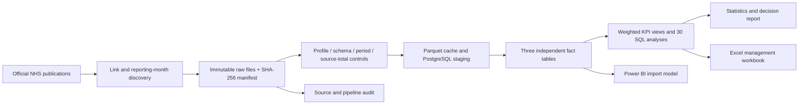
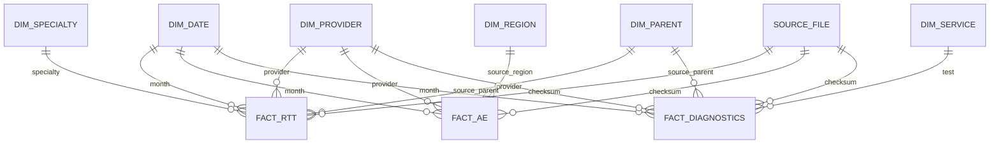

# Architecture and modelling decisions

RTT grain: reporting month/provider/specialty/pathway type. DM01: reporting month/provider/test. A&E: reporting month/provider. Commissioner-level raw rows aggregate once into provider facts. Redundant all-specialty/test/national totals remain controls only. Dates are daily and facts use the first day of the reporting month. Single-direction dimension-to-fact relationships avoid many-to-many inflation.

Provider code is the analytical identifier, not a claim of trust/site equivalence. The provider-name dimension is type 1 with latest source date. Source parent ICB fields stay with the appropriate facts; a current geographic lookup is never backdated. A&E regional analysis uses the source monthly region. Official current A&E mapping is retained for reference only and is not used to manufacture historical regional RTT/DM01 mappings.

Each revised file is immutable and identified by checksum. Changed source month is replaced transactionally after dimension upserts; a successful audit row records parser version and count. Same checksum/version skips the load. Failures roll back the affected month. This favours correctness over unsupported append-only incrementality.
